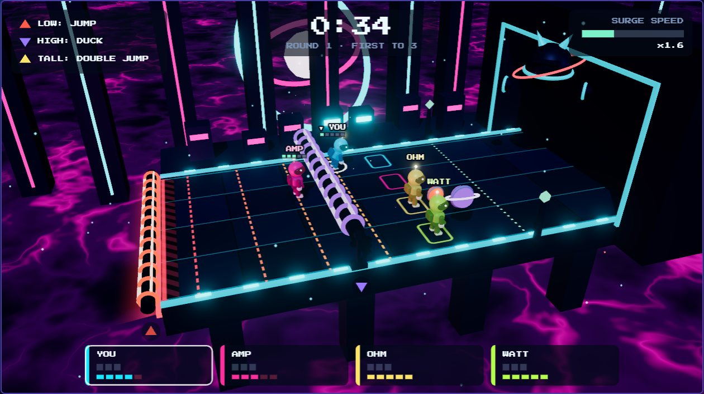
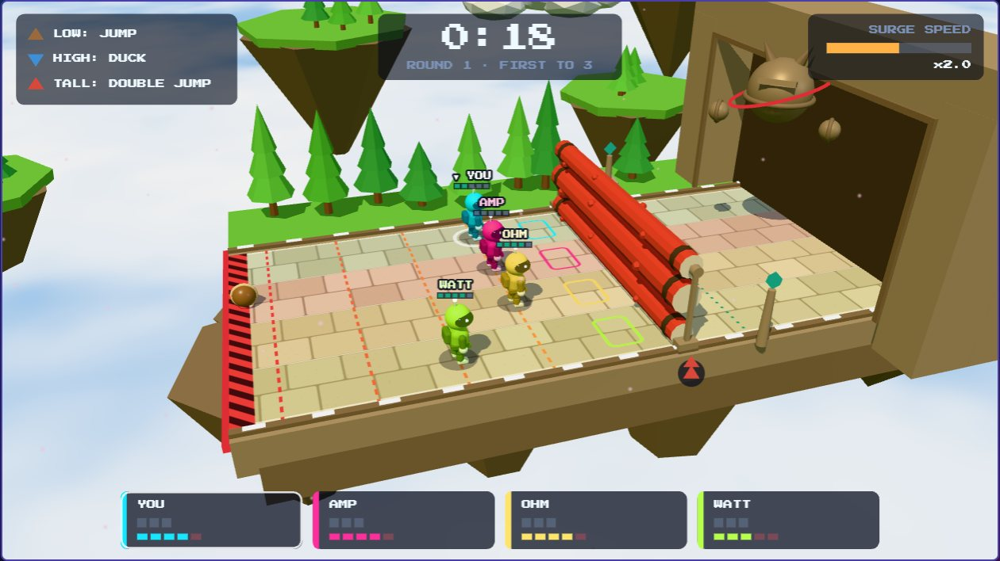
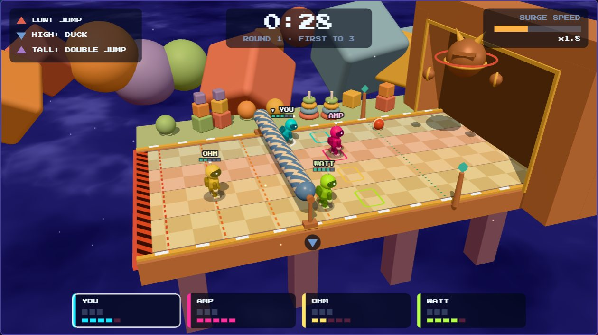
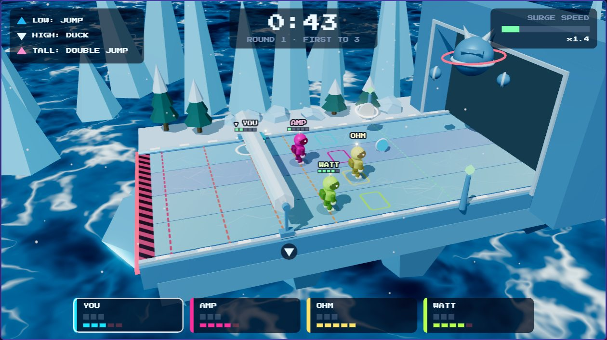
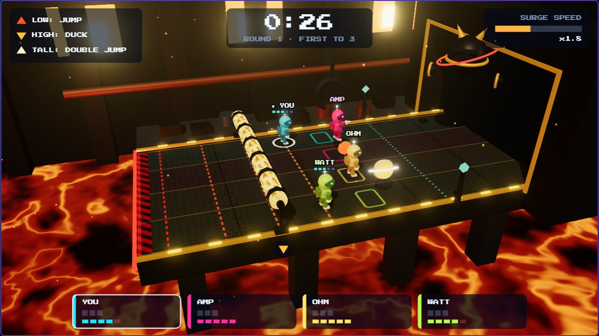

# Fuse Surge

Fuse Surge is a last-rider-standing dodge game for two to five, served at `/fuse-surge/` (locally
**http://localhost:8787/fuse-surge/?mute**). Riders stand side by side on a deck over a plasma pit, each in its own
lane, and surges of charge sweep the deck toward the edge, faster and faster. Play friends online, on one TV with
phones as the controllers, or bots.

## How to play

- **Jump the low surges, duck the high ones.** A low surge rolls along the deck and strikes feet on it. A high one
  is the same roller floating at head height on two thin posts: it strikes whatever is between its bottom and its
  top, so a duck fits under it and feet above it pass over it (a single jump manages that only at its very peak).
  The arrow under each surge says which it is, and the legend at the top left shows the colours the look in use
  gives them.
- **A hit throws you one foothold back** toward the pit. Take the match's hits (three by default) and you are off the
  edge. Nothing can strike you while you are thrown back, or for a moment after.
- **Tap to hop, hold to jump high.** A tap is a short hop that lands quickly; holding jump rises about twice as high
  and stays up longer.
- **Duck in the air to dive.** Let go of jump and hold duck: the rider drops hard and lands ducking, which is how a
  low surge followed closely by a high one is cleared. While jump is held it wins.
- **Comeback.** Five clean dodges in a row win a foothold back (the pips over a rider's head count them). A rider
  near the edge also has longer to read each surge, since surges reach it later.
- **Flip surges** carry a FLIP tag and a spinning marker: they change height as they cross the dotted gate line, so
  read them as the kind they are about to become.
- **Speed.** Surges speed up and come closer together all through a round, along one curve that a round of any
  length runs from start to finish: a one-minute round climbs fast, a five-minute one slowly, and both end equally
  hard. The bar at the top right shows how much.
- **Rounds.** The last rider standing takes the round. Riders knocked off by the same surge draw it and each take a
  win, and when the round's clock runs out (two minutes by default) everyone still standing draws it. An **endless**
  round has no clock: it keeps climbing, past where a timed round ends, until one rider is left. First to the
  match's round wins takes the match; riders who get there together draw the match.

## Match settings

The host chooses them in the lobby (GAME SETTINGS), and the main menu's Settings holds the ones a solo match uses:

| Setting      | Choices                   | Default  |
| ------------ | ------------------------- | -------- |
| **HITS**     | 2, 3, 4, 5                | 3        |
| **ROUND**    | 1, 2, 3, 5 min or ENDLESS | 2 min    |
| **PACE**     | CHILL, STANDARD, FRANTIC  | STANDARD |
| **FIRST TO** | 1, 2, 3 or 5 round wins   | 3        |
| **COMEBACK** | ON, OFF                   | ON       |
| **BOTS**     | EASY, NORMAL, HARD        | NORMAL   |

The rules take more than the buttons offer: 1 to 9 hits and any round of 10 to 600 seconds (0 is endless). A link
sets them (`?solo=1&hits=7&seconds=45&pace=2&target=1&recover=0&bot=2`), and so does the developer hook below.

### Experiments

Four more rules, each a switch of its own under **EXPERIMENTS** in the same settings (and `double`, `tall`, `boss`
and `glide` as `0` or `1` in a link). They are there to be tried: turn any of them off and the game is as it was
without it.

| Switch          | Default | What it does                                                                                                                                                                                                                 |
| --------------- | ------- | ---------------------------------------------------------------------------------------------------------------------------------------------------------------------------------------------------------------------------- |
| **DOUBLE JUMP** | ON      | Press jump again in the air for a second jump, once until landing. Held, it adds about as much height again; tapped, a hop.                                                                                                  |
| **TALL SURGES** | ON      | A stack from the deck up, in a colour of its own: no ducking it and no single jump clears it, only a double jump. It is announced (TALL NEXT) one spawn early, and the deck is clear before and after it. Needs DOUBLE JUMP. |
| **WARDEN**      | ON      | A boss over the arch answers some spawns with a volley of bolts, one down each of some lanes: a ball rolling on the deck (jump it) or hovering at head height (duck it). Each rider reads their own lane.                    |
| **GLIDE**       | OFF     | Hold jump while falling to come down softly; let go to fall, duck to dive.                                                                                                                                                   |

## Looks

How a match is drawn is each device's own choice and changes nothing about the match: two riders in one room can
each pick a different look. Choose one under **LOOK** in the main menu's Settings or in the lobby, press the
**LOOK** button (or **L**) during a match to step through them, or open a link with `?look=forge`. The browser
remembers the last one.

| Look         | `?look=`  | What it is                                                          |
| ------------ | --------- | ------------------------------------------------------------------- |
| **REACTOR**  | `reactor` | 3D, the default. A neon deck over a plasma core, with glowing coils |
| **SKY ISLE** | `skyisle` | 3D. A stone bridge above the clouds, with rolling logs              |
| **TOY BOX**  | `toybox`  | 3D. A cozy playroom of wooden blocks at dusk, with candy rollers    |
| **GLACIER**  | `glacier` | 3D. An ice shelf over a freezing sea, with rollers of ice           |
| **FORGE**    | `forge`   | 3D. Steel over molten metal, with hot pipes                         |
| **PIXEL 2D** | `classic` | The flat pixel picture the game began with                          |

The 3D looks need WebGL; a device without it shows PIXEL 2D.

|                                          |                                           |
| ---------------------------------------- | ----------------------------------------- |
|  |  |
|   |   |
|      |                                           |

## Controls

| Move | Keyboard                | Touch | Gamepad                                      |
| ---- | ----------------------- | ----- | -------------------------------------------- |
| Jump | W, ↑, Space or K        | JUMP  | A, Y, the right shoulder, stick or d-pad up  |
| Duck | S, ↓, either Shift or J | DUCK  | B, X, the left shoulder, stick or d-pad down |

On a shared screen (tick **Shared TV** before creating the room, then **OPEN TV SCREEN** in the lobby) the TV shows
the deck and each phone becomes a full-screen DUCK and JUMP pad that buzzes when its rider is struck.

## How it is built

- `src/engine/`: integer fixed-point rules at 120 steps a second, six per 50 ms log tick (`tuning.ts` holds every
  number). Surges are drawn from the world's own seeded generator, which is part of the checkpoint, so every device
  and every replay sees the same deck. The bot (`bot.ts`) has no memory: it follows a sound plan except for the
  surges it fumbles, which are picked by mixing the match's seed with the surge. `RULES` in `src/engine/index.ts`
  names the rules version; `tests/engine.test.ts` checks that sound play is never struck at any pace, any round
  length and with any of the switchable rules, so every pattern the deck sends can be cleared.
- `src/online/`: the game behind `fuse-netcode`'s `RollbackGame` and the room runtime, the same stack as Fuse Volley.
  A match is one scope; its rounds are the engine's.
- `src/render/`: the picture. `looks.ts` holds every look as data; `show.ts` puts the chosen one on the page and
  fetches the 3D renderer the first time it is needed. `three/` is the three.js stage (the set, jointed riders,
  the surges, bolts and the Warden, sparks, bloom where a look has it) with `hud.ts` as the flat layer of names and
  scores over it;
  `stage-kit.ts` holds the arithmetic they stand on (stances, joints, the camera fit); `scene.ts` is the Canvas 2D
  pixel look. Cues and rollback smoothing are shared. Everything here is cosmetic and reads views only: a rider
  is drawn where the rules have it, and a ducked figure fits under the surge it clears.
- `src/app/`: the page, controls (keys, touch buttons, gamepads), sounds and the forward run: each frame plays the
  newest folded world forward on a copy to the clock, so a press shows within one log tick.

Developer flags: `?mute`, `?autopilot` (this device plays with the hard bot's answers), `?lead=local` (draw your own
rider with the keys held right now rather than the ones last logged), and `?debug`, which puts `window.fuseSurge` on
the page: `fuseSurge.view()` is the newest frame, and `fuseSurge.set({ hits: 7, seconds: 45 })` asks the room for
other settings (the host, in the lobby), including values the lobby's buttons do not offer.

Production serves its rooms, like every game registered in `service/history.ts`.

Checks: `pnpm exec tsx --test games/fuse-surge/tests/*.test.ts`.
